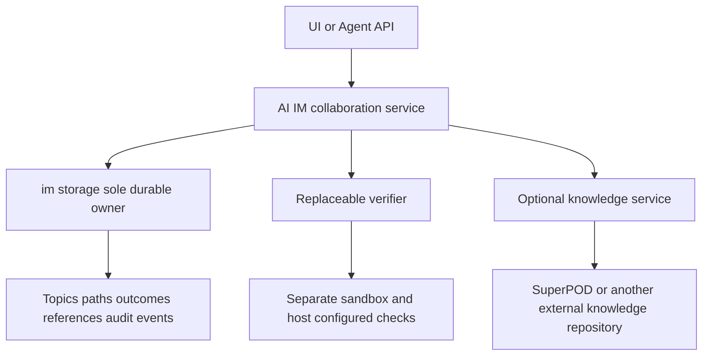

# 07 Outcome collaboration architecture

[Documentation](../00-index.md) · [Design index](00-index.md) · [简体中文](../../zh-CN/design/07-outcomes.md)

Outcome collaboration connects goal paths within a shared topic through durable, reusable findings. Each outcome states a conclusion, applicability conditions, pinned evidence and provenance. Consumers explicitly reference it and publish their own outcomes. Publication, verification, host acceptance and external knowledge updates have separate records.

## Messages and subagents

| Mechanism | Unit | Relationship | Completion | Responsibility |
| --- | --- | --- | --- | --- |
| Messaging | Message, conversation, reply | Author and audience | Delivery or response | Questions, discussion, notifications and context |
| Subagents | Delegated task and attempt | Parent and executor | An execution returns a result | Decomposition, parallel execution and submission |
| Outcome collaboration | Immutable outcome version and evidence | References across goal paths | Valid verification and host acceptance | Discovery, reuse, challenges, revision and accumulation |

Messages can link outcomes; a parent can delegate production or verification to subagents. Humans and Agents can publish. Task trees, reply trees, outcome graphs and research lineage remain distinct; success never transfers implicitly between them. This is the system's separation of responsibilities, not a claim that all external subagent implementations behave alike.

## Domain model

| Object | Content | Constraint |
| --- | --- | --- |
| Topic | Shared question and conversation | Existing topic and inherited group membership |
| OutcomePath | Goal ID, name, hypothesis | Goal belongs to the topic's group; association is immutable |
| Outcome | Kind, conclusion, conditions, evidence, author, pins, attempt | Immutable; revision has a new ID and `supersedes` |
| OutcomeReference | Source outcome, `uses` / `supports` / `challenges`, reason | Existing same-topic sources make the graph acyclic |
| OutcomeVerification | Outcome digest, verifier configuration digest, request digest, deadline, receipt | Independent of the author's claim; fenced terminal receipt |
| OutcomeDecision | Verification request, accepted/returned, reason | Host only; does not complete a Goal |
| KnowledgeWrite | Acceptance, outcome, target, expected revision, service digest, receipt | Optional explicit update; reconcile uncertain effects |

Kinds are finding, experiment, counterexample and artifact. Negative evidence and limitations are useful outcomes. Evidence references contain repository, full commit, relative path and SHA-256. Full artifacts, raw runs, private holdouts and knowledge contents stay in their owning systems. Source commit and prompt/policy digests are required. SuperPOD is optional; unbound outcomes have no fabricated SuperPOD commit. Optional external provenance freezes the service, repository and revision.

## Services

`contracts` owns lifecycle enums and generates frontend contracts. `collaboration-store` owns domain transactions within `collaboration-storage-service`; other services use its API. `collaboration-api` supplies authorization, verification dispatch and UI APIs. Services communicate over versioned private Unix sockets. The development embedded adapter uses the same client contract and a separate local store.

Core collaboration starts without research CLI configuration, SuperPOD, a verifier or knowledge binding. Publishing, discovery and referencing remain available without verification services; unverified outcomes cannot be accepted. Service settings track endpoint, enabled state, protocol, supported kinds, dependencies and deadline. Configuration, protocol health and actual task results remain distinct. Automatic verification is bound by topic and outcome kind; knowledge binding is optional per topic.

## Lifecycles and transactions

Publication uses `published / withdrawn`; verification uses `unverified / running / passed / failed / unavailable / unknown`; acceptance uses `pending / accepted / returned`. Knowledge updates use their own `pending / applied / failed / unknown`. Withdrawal retains history. New versions require new verification and acceptance. Starting a new verification invalidates the current projection of an old acceptance. Cancelled or retried source attempts cannot retain a current verification, while historical records remain readable.

Bearer publication rechecks credentials, group membership, Goal, WorkItem, attempt, claim and live execution lease inside the storage transaction. Agents cannot create verifier receipts, host acceptance or knowledge receipts. Hosts may publish manually with their own provenance. Management HTTP endpoints also reject forged internal receipt commands; only service orchestration can use them.

Verifiers receive the pinned outcome and request and return a matching structured receipt. Passed and failed receipts require evidence. Unknown protocol states, unavailable services, timeouts, mismatches and stale attempts never imply success. The host accepts only the current successful verification. Existing research assessment and promotion gates remain independent.

Publication and references commit atomically. Equal ID/content/author retries are idempotent; mutations conflict. Service requests are durable before dispatch. After a host crash, unfinished verification becomes unknown at its deadline and can be replaced by a new request. Potentially applied knowledge writes are never automatically replayed.

## Discovery

Sharing and references are limited to one Topic. Keyword, goal path and kind filters return at most 32 summaries per page, with details fetched separately. Pagination freezes the publication sequence upper bound; new publications do not displace old pages. Verification, acceptance and withdrawal are current projections.

Ranking prefers title matches, then references within the frozen window capped at eight ranking contributions, then recent publications. Popularity is not truth. Summaries are at most 4096 bytes, with at most 16 evidence items and 16 references per outcome and a 64 KiB input bound. A store allows 100,000 outcomes, 100,000 path associations and 500,000 audit events. Host service execution concurrency is eight. This release provides no public cross-topic index, dynamic Agent scaling, global model token budget or automatic outcome merging.

## Optional external knowledge

SuperPOD and other stores implement the replaceable knowledge protocol. Unbinding preserves historical provenance and receipts. A write freezes acceptance, outcome digest, target, expected revision and service configuration.

The supplied `outcome-hub-outcomes` Git adapter writes accepted records and receipts to a prepared import branch in an external repository. It builds a commit with an isolated temporary index and atomically compares and swaps the branch's old revision. It refuses checked-out branches, does not push or merge the default branch, and does not edit SuperPOD knowledge maps. The repository maintainer consumes the import branch through existing review, indexing and publication workflows. Other adapters may implement their target system's native update transaction.

Private service state retains idempotency receipts, and the target commit contains the request digest. Disconnects and interruptions require receipt lookup without replaying the write. Confirmed failure permits a new corrected request; unknown effects block another write. A later withdrawal cannot erase an external update that already happened. Corrections require a subsequent knowledge version.

## Verification and evaluation

Regression checks cover authority, attempt fencing, same-topic references, persistence, bounded summary pagination, receipt mismatch, unknown states, independent acceptance, Git CAS, idempotency and lost receipt reconciliation. Delivery requires all Bazel tests, full Qualitygate and domain review. These engineering checks establish tested contract behavior, not universal correctness of outcome contents.

Comparisons against single Agents, subagents and message collaboration should freeze task, model, prompts, policy, budget, source and evaluation set. Count generation, discovery, verification and failed retry costs consistently. Measure accepted quality, first useful reuse, duplicated work, error propagation and latency. Retain negative samples and independent host acceptance; derive benefit claims from actual controlled runs.

Design reference: slides 20–22 of `agent-space-bp-2027-editable-v42.html`, SHA-256 `0a6e48a2ac5581b752b1a24edee46562dcfe633fcfa0407687f5634a3ae79053`. The contracts implement durable intermediate outcomes, bounded discovery, reuse across paths and independent verification.
