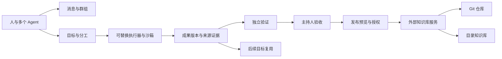

# OutcomeHub：基于成果协作的多 Agent 作业系统

## 协作过程

目标定义要完成的工作与验收条件；参与者通过消息沟通，通过执行适配器完成任务。每次执行属于明确的目标尝试。成果保存独立版本、来源证据和引用关系，验证器提供证据，主持人作出验收决定。已验收成果可以由操作者明确发布到一个外部知识库。

消息发送、子 Agent 返回、执行完成、验证通过、验收通过和外部发布分别记录。未知执行状态或缺失发布回执不会被解释为成功。临时会话成员固定且没有自动过期时间。

## 模块所有权

| 模块 | 所有权与边界 |
| --- | --- |
| `apps/outcome-hub`、`apps/cli`、`apps/console` | 应用入口与能力组合 |
| `collaboration-model`、`contracts` | 领域数据与唯一的共享状态定义 |
| `collaboration-store` | 身份、消息、目标、成果及谱系的数据库事务 |
| `collaboration-storage-service` | 生产协作数据库的唯一服务所有者 |
| `collaboration-client` | 远程与显式开发适配器共用的客户端契约 |
| `collaboration-api`、`collaboration-host` | HTTP、事件流、授权和启动组合 |
| `execution-*`、`agent-teams` | 作业执行、团队组织、输入冻结及预算 |
| `executor-service`、`sandbox-service`、Agent 适配器 | 可替换、有界的执行能力 |
| `knowledge-model`、`knowledge-client` | 外部知识库通用协议与客户端 |
| `knowledge-service` | 知识库配置版本、发布协调、记录与核对 |
| `knowledge-git`、`knowledge-directory` | 外部目标的具体读写能力 |
| `knowledge-publication` | 显式布局与索引适配器驱动的报告交付流程 |
| `web/*` | 独立前端资产；共享契约从 Rust 生成 |

`crates/` 保持扁平。应用不直接共享生产数据库句柄；API 不依赖知识库适配器或研究执行实现。嵌入式开发存储使用相同客户端协议与独立本地存储。

## 外部知识库

没有知识库配置时仍可使用核心作业系统。知识库服务独立保存目标配置与发布记录；正文存放在用户选择的仓外目标。一次发布明确选择一个目标，成果引用和发布回执记录其位置及版本。SuperPOD 使用同一配置与协议。

预览返回的基线令牌绑定目标内容版本、配置版本、目标身份和成果摘要。发布前校验令牌、成果摘要及验收绑定。目录适配器使用文件描述符限定路径、拒绝符号链接、原子替换单文件并记录日志和回执；外部普通文件编辑器不参与它的锁，因此仍须通过内容基线检测冲突。Git 适配器使用独立临时索引与比较交换更新未检出的目标分支，不修改用户当前工作区。

## 兼容与验证

仅保留 OutcomeHub 正式命令和版本化 HTTP 路径；历史可变状态通过独立离线工具迁移。状态值、协议字段及冻结证据摘要保留，数据目录由操作者显式切换。新增知识管理操作要求支持该操作的知识库服务；旧 Git 发布服务仍提供原协议，不伪报新能力。

Bazel 依赖图测试验证真实依赖边界；协议夹具验证序列化；真实 Git 和临时目录测试验证发布、冲突与回执；HTTP 测试验证兼容路由与角色边界。文字扫描只用于语言边界，不能替代这些验证或架构审查。
