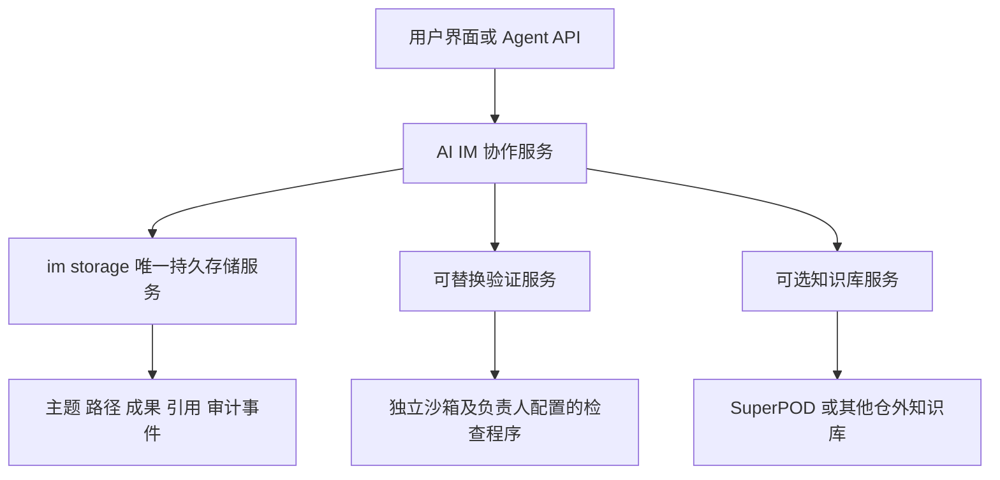
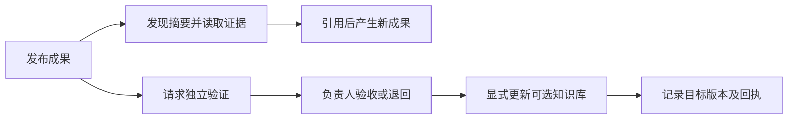

# 07 基于成果的协作架构

[文档首页](../00-index.md) · [本目录](00-index.md) · [English](../../en/design/07-outcomes.md)

成果协作让多个目标路径围绕同一主题交换可复用的进展。每份成果都包含明确结论、适用条件、固定版本证据和来源；其他路径通过显式引用使用它，再产生自己的成果。系统分别记录发布、验证、负责人验收和知识库写入，避免把一次执行成功当成组织已经接受的知识。

## 与消息和 subagents 的关系

| 机制 | 协作单元 | 主要关系 | 完成的含义 | 在本系统中的职责 |
| --- | --- | --- | --- | --- |
| 消息协作 | 消息、会话、回复 | 发言者与受众 | 已送达或已回复 | 提问、讨论、通知、说明上下文 |
| subagents | 被委派的任务与执行尝试 | 主 Agent 与执行者 | 该次任务返回结果 | 分解工作、并行执行、汇总提交 |
| 成果协作 | 不可变成果版本及证据 | 目标路径之间的引用 | 验证记录和负责人验收均有效 | 跨路径发现、复用、质疑、修订和积累 |

消息可携带成果链接；主 Agent 可让 subagents 产生或验证成果；成果作者可以是人或 Agent。任务树、消息回复树、成果引用图与研究版本谱系各自表达不同关系，不互相推导成功状态。该分层是本系统的契约，不限定外部 subagent 产品必须采用哪一种实现。

## 领域对象与归属

| 对象 | 必须表达的内容 | 约束 |
| --- | --- | --- |
| Topic | 共同问题与协作群 | 沿用既有主题，继承群成员权限 |
| OutcomePath | 目标 ID、路径名称、待验证假设 | 目标必须属于主题的群；关联发布后不可改写 |
| Outcome | 类型、结论、条件、证据、作者、来源版本、执行尝试 | 发布后不可覆盖；修订使用新 ID 与 `supersedes` |
| OutcomeReference | 来源成果、`uses` / `supports` / `challenges`、理由 | 只引用同主题中已经存在的成果，因而无环 |
| OutcomeVerification | 成果摘要、验证服务配置摘要、请求摘要、截止时间、回执 | 独立于作者声称；过期或不匹配回执不能通过 |
| OutcomeDecision | 指向验证请求的验收或退回及理由 | 只有负责人操作；不自动完成 Goal |
| KnowledgeWrite | 验收 ID、成果摘要、知识库目标、预期版本、服务摘要、回执 | 可选；明确发起；未知结果先核对回执 |

成果分为研究发现、实验结果、反例和制品。负面结果和适用边界可以成为有价值的成果。证据只存仓库标识、完整提交、相对路径和 SHA-256；大文件、原始运行、私有评测数据及知识库正文留在原属系统。必填来源为源码提交、提示词和策略摘要；未绑定 SuperPOD 时 `superpod` 为空，不编造提交。绑定外部知识来源时还保存服务、仓库和来源版本。

## 服务结构

`contracts` 是生命周期枚举的唯一来源，前端契约由其生成。`crystal` 实现领域事务；生产数据库由 `im-storage` 独占。`im-service` 提供权限、自动验证调度和界面 API；其他服务通过版本化私有 Unix socket 通信。开发用嵌入存储使用同一客户端契约和独立本地数据目录。

核心启动无需研究 CLI、SuperPOD、验证服务或知识库绑定。没有验证器时仍可发布、发现和引用，状态保持未验证。服务配置包含端点、启用状态、协议版本、成果类型、依赖和时限；配置成功、协议健康和实际验证通过分别表达。按主题、成果类型绑定自动验证器，按主题可选绑定知识库。

## 状态与事务

发布状态为 `published / withdrawn`；验证状态为 `unverified / running / passed / failed / unavailable / unknown`；验收状态为 `pending / accepted / returned`。知识库写入使用单独的 `pending / applied / failed / unknown`。撤回不删除历史；新版本必须重新验证、重新验收。重新发起验证会使旧验收失去当前有效性；取消或重试源执行尝试会使旧尝试的验证失效，历史记录仍可读。

Agent 通过 bearer 凭据发布时，存储事务再次检查凭据、群成员身份以及当前 Goal、WorkItem、attempt、claim 和运行租约。Agent 不能写入验证、验收或知识库回执。负责人可手工发布并记录自己的来源。HTTP 管理接口也禁止直接伪造内部验证和写入回执；只有服务执行路径能调用这些存储命令。

验证器收到固定成果和验证请求，返回绑定请求摘要的结构化回执。`passed` 和 `failed` 均要求证据。未知协议状态、不可用服务、超时、失配回执和旧尝试不构成通过。负责人对当前有效的通过回执作验收决定；已有研究评估和晋级仍执行原门禁。

发布与关系写入为一个事务；同 ID 同内容同作者请求幂等，不同内容冲突。验证与写入先持久记录请求，再执行服务调用。宿主崩溃后未结束的验证在截止后显示未知，可新建验证请求；系统不自动重放可能已发生副作用的知识库写入。

## 发现与复用

首版在同一 Topic 内共享，跨 Topic 引用被拒绝。搜索支持关键词、目标路径、成果类型，每页最多 32 份摘要，完整证据通过详情读取。分页固定成果序号上界，期间新发布的成果不会挤入旧页面；验证、验收和撤回状态仍以当前记录为准。

标题匹配优先，其后参考窗口内的复用次数，排序贡献最多计 8 次，再按新旧排序。引用次数只是发现线索，不是验证证据。每条摘要最多 4096 字节；每份成果最多 16 项证据和 16 条引用，输入最多 64 KiB；每库最多 10 万份成果、10 万条路径关联和 50 万条审计事件。服务执行并发最多 8 个。首版不包含跨主题公共索引、动态 Agent 扩缩容、全局模型 token 预算或自动成果合并。

## 可选仓外知识库

SuperPOD 与其他知识库都通过可替换知识服务接入。取消绑定不删除已有来源和写入回执。接受成果与写入知识库是两个独立动作；写入必须固定当前验收、目标知识库、预期版本和服务配置。

附带 `ai-im-outcome-service` 的 Git 适配器把已验收成果及收据写到外部仓库的预备导入分支，用独立临时索引构造提交，再以旧提交作比较并交换更新分支。它拒绝修改任何已检出的目标分支，不推送远程、不合并默认分支，也不修改 SuperPOD 知识地图。导入分支由知识库维护者通过原有审核、索引和发布流程消费。其他知识服务可按同一协议实现目标系统的更新事务。

服务私有目录保留幂等回执，目标提交同时保留请求摘要。网络断开或进程中断后，先查询回执；查询不会重做写入。明确失败才可修复后提交新请求；结果未知时阻止再次写入。外部提交一旦发生，回执保留该事实，即使后来撤回成果也不能把已发生的更新伪装为未发生；纠正通过知识库后续版本完成。

## 验证与评估

回归覆盖 Agent 权限、当前尝试、同主题引用、重启持久性、摘要分页、回执失配、未知状态、验收分离、知识库 CAS、幂等和丢失回执核对。完整验收还需 Bazel 全仓测试、Qualitygate 和领域语义审查。工程用例证明这些契约的已测行为，不代表成果内容天然正确。

若比较单 Agent、subagents、消息协作与成果协作，应冻结同一任务、模型、提示词、策略、预算、源码和评测集；统一计入生成、发现、验证与失败重试成本，记录验收质量、首次有效复用时间、重复工作、错误传播和总时延。保留负面样本、用宿主独立验收，收益结论来自实际对照运行。

设计参考：`agent-space-bp-2027-editable-v42.html` 第 20–22 页；文件 SHA-256 为 `0a6e48a2ac5581b752b1a24edee46562dcfe633fcfa0407687f5634a3ae79053`。本实现将其中的中间成果、有限发现、跨路径复用和独立验证落为上述系统契约。
